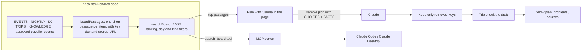

# Yatra Pulse: specification

Yatra Pulse is a live travel board for **Mysuru Dasara 2026 (11–21 October)**. It helps a traveller who wants the culture, not just the crowd, to see what's on, plan a day-by-day itinerary that actually works on the ground, book official tickets safely, and find day trips. A Gaya panel covers Pitru Paksha for spiritual travellers.

| | |
|---|---|
| Live board | https://claude.ai/artifact/1KQUyk25gdmTGtbnHSxgJX (claude.ai Artifact) |
| Design guide | [`docs/design.html`](docs/design.html) · https://claude.ai/artifact/2PCxFoPpMJ7vepwaYKzcYE |
| Code | `index.html` (the whole app), `mcp-server/` (MCP + RAG), `tests/`, `video/` |
| Video walkthrough | https://www.youtube.com/watch?v=VNpOtIx-vuU |
| Data last checked | 11 October 2026 |

---

## 1. Users and goals

| User | Goal | Served by |
|---|---|---|
| Traveller in Mysuru | Know what's on now and next | Header, Now & next |
| Planner before the trip | Build a realistic day-by-day plan | My itinerary, Trip check, Plan with Claude |
| Ticket buyer | Book the right tickets, officially, without clashes | How to book, Book tickets check |
| Music / nightlife fan | Concerts and DJ nights | Timeline filters, Picks, DJ & party nights |
| Spiritual traveller | Rituals, temples, Gaya rites | Ritual filter, Picks (Spiritual), Gaya panel, day trips |
| Local / fellow traveller | Share genuine events | Traveller events (host-approved) |
| Host (board owner) | Keep the board genuine | Review queue, approve / don't add |
| Developer using Claude | Ask Claude grounded Dasara questions | MCP server with RAG |

## 2. Use cases

Each use case lists what the user does, what the system does, and how it's verified (Selenium `tests/run_dashboard.py`, MCP `mcp-server/test.js`).

| # | Use case | System behaviour | Test |
|---|---|---|---|
| UC1 | See the festival day and countdown | Day N of 11 and time to Jamboo Savari (21 Oct, 4:10 pm IST), refreshed every minute | Page loads |
| UC2 | See what's live and next | Up to 4 cards; live first, then soonest; status pill by time in IST | Now & next |
| UC3 | Browse the 11-day timeline | One row per day; today highlighted, past days faded; every event links to its source | Source links |
| UC4 | Filter events | All / Concerts / DJ & party / Ritual / Shows; choice remembered | Concerts filter |
| UC5 | Get picks for a travel style | Spiritual / Music & DJ / Heritage / Family → 3 upcoming events + 2 day trips | Picks |
| UC6 | Find DJ and party nights | Mysuru and Bengaluru listings, with an honest note that no club nights are announced | — |
| UC7 | Add stops to an itinerary | "+ Add to plan" on any event, nightly show, day trip or approved traveller event; grouped by day and time | Add / remove |
| UC8 | Detect clashes | Two stops at different venues that overlap → **Clash** | Trip check clash |
| UC9 | Check travel between stops | Gap vs travel time for car, two-wheeler, auto-rickshaw or bus → OK / Tight / Not enough time, with a Google Maps route | Travel time |
| UC10 | Respect gate deadlines | Jamboo Savari "be inside by 12:30 pm", roads closed from 11 am | Gate time |
| UC11 | Vehicle range | Auto-rickshaw on a trip over 40 km → **Too far** | Far trip by auto |
| UC12 | Warn before booking | "Book tickets" runs trip check for that event first and shows the result | Book tickets warns |
| UC13 | Copy / share the plan | Plain-text plan to the clipboard for WhatsApp or email | — |
| UC14 | Plan with Claude | Retrieve matching events and facts (RAG) → Claude drafts → trip check reviews the draft → "Add all" | Board search |
| UC15 | Learn how to book | Official site, steps, prices, collection counter, gates, helpline | — |
| UC16 | Add a traveller event | Form with checks; saved privately until the host approves | Traveller form |
| UC17 | Host review | Owner sees the queue; Approve publishes it, Don't add rejects it | (needs claude.ai) |
| UC18 | Day trips | 9 trips sorted by distance, each with a link and add button | Add day trip |
| UC19 | Gaya Pitru Paksha | Status (ended 10 Oct, next ~Sept 2027), rites, nearby places | — |
| UC20 | Dark mode and phone | Follows device theme; one column under 900px; no sideways scrolling | Video scenes |
| UC21 | Ask Claude via MCP | `search_board`, `get_day`, `check_itinerary`, `booking_guide`, `plan_trip` | MCP 8 checks |

## 3. Components

The page is one HTML file. Each component below is marked with a `<!-- Component: … -->` comment in `index.html`, and shown live in the design guide.

### 3.1 Palace-bulb strip
Decorative top border of marigold dots (CSS `radial-gradient`) that twinkles; motion stops with `prefers-reduced-motion`. Sets the "palace on a Dasara night" identity.

### 3.2 Header
Brand name plus two stat tiles: **festival day** (`#dayNum`, "1 / 11") and **countdown** to Jamboo Savari (`#cd`). Both computed by `render()` from the current time in IST.

### 3.3 Status pill
`.pill.live | .soon | .tba | .done | .ok | .bad`. Chosen by `state(occurrence, now)`: *Live now* (between start and end), *Starts 7:00 pm* (within 6 hours), *Today · time TBA*, *Time TBA*, *Ended*. Always text plus color.

### 3.4 Now & next
`.ncard` cards in an auto-fit grid. Live occurrences sort first, then by start; one card per title, four at most. Each card: pill, title, time, venue, source link, add button.

### 3.5 My itinerary
- **Day groups** (`.pday`): stops sorted by when you must be there (gate close time if the ticket has one, else start).
- **Stop row**: time, title, venue, "until" time, source, remove (`.rm[data-rm]`).
- **Controls**: *Getting around by* (car or taxi, two-wheeler, auto-rickshaw, bus), *Day trips and nightly events go on* (day picker), *Copy plan*, *Clear* (asks for a second tap).
- **Storage**: `data/users/<you>/plan` in the artifact database when signed in on claude.ai, otherwise this browser.

### 3.6 Trip check
Runs on every render of the itinerary, on "+ Add to plan", on "Book tickets", on Plan with Claude drafts, and in the MCP server. See §5 for the rules.
- **Leg row** (`.leg[data-status]`) between stops: `bad` (!), `warn` (~), `ok` (↓), with a reason and a **Route ↗** Google Maps link.
- **Summary pills**: "1 problem · 1 to watch" or "All stops reachable".
- **Toast** (`#toast`, `role="status"`): the result for the stop you just added or are about to book.

### 3.7 Plan with Claude
Form: arriving day, length (1–5 days), style, pace, optional note. On submit: **retrieve** passages (§6), ask Claude via the artifact `sample` capability for JSON, **drop any key that wasn't retrieved**, **trip-check** the draft, show the plan, the trip-check result, tips (from retrieved facts only) and the sources read. "Add all to my plan" merges the stops. Hidden behind a message when not on claude.ai.

### 3.8 Timeline
Filter chips (`.chipbtn[data-f]`), the **nightly band** (palace illumination, classical stage, exhibition), and 11 **day rows** (`.day`) with events (`.ev[data-cat]`: red rule for music/DJ, marigold for ritual). Each event: title, pill, time, venue, note, source, **Book tickets** (where ticketed), add button.

### 3.9 Sidebar
- **Picks for you**: style chips (`[data-v]`) → upcoming events with matching tags + day trips.
- **DJ & party nights**: three listings with sources and a note on what isn't announced.
- **Gaya · Pitru Paksha**: status pill, rites, nearby places.

### 3.10 Traveller events
- **Approved cards** (`.ccard`): everyone sees them; "Checked by host", who added it, source, add button.
- **Your submissions**: your own, with *Waiting for check / Checked / Not added*.
- **Host review queue**: owner only; Approve / Don't add.
- **Add form**: name, official link, date (11–31 Oct), type, venue, write-up (40–400 chars), "this is real" tick. `validate()` rejects non-https links, link shorteners, duplicates, and more than 5 waiting per person.

### 3.11 How to book
Numbered steps (a real sequence): check your itinerary → official site → pay → collect at Spandhana Counter with ID → on the day. Price table (`.prices` in `.tablewrap`) with totals including fee and GST; helpline 1077; getting-there tips.

### 3.12 Day trips
`.trip` cards with distance, why go, link and add button. Each has coordinates so trip check can estimate the drive and return time.

### 3.13 Footer
Last-checked date and every source.

## 4. Data model

All board data lives in `index.html` between `/* SHARED-START */` and `/* SHARED-END */`.

| Name | Shape | Notes |
|---|---|---|
| `EVENTS` | `{title, url, book?, place, venue, d, s, e, cat, tags, note, tba?, crowd?, arriveBy?}` | `d` = day of October; `s`/`e` = HH:MM IST; `arriveBy` = gate close |
| `NIGHTLY` | `{title, url, venue, s, e, cat, tags, place, note}` | Every night 11–21 Oct |
| `DJ` | `{title, url, meta, note}` | |
| `TRIPS` | `{name, url, at:[lat,lng], km, tags, why}` | |
| `VENUES` | `{palace, chamundi, bannimantap, exhibition, uttanahalli}` → `{name, at}` | Approximate coordinates |
| `MODES` | `{car, bike, auto, bus}` → `{label, city, road, wait, maxKm}` | km/h, minutes |
| `KNOWLEDGE` | `{id, title, text, url}` | Booking, prices, gates, travel, Yuva Dasara, DJ, Gaya |
| Plan item | `{key, day, title, time, place, url}` | Keys: `ev:<day>:<title>`, `nt:<title>`, `trip:<name>[@day]`, `cm:<id>` |

Database (claude.ai artifact `db` capability):

| Path | Who reads | Who writes |
|---|---|---|
| `approved/<id>` | Everyone | Editors and owner |
| `tips/<userId>` → `{items:[…]}` | That user and editors/owner | That user (Contributor+); owner updates status |
| `data/users/<userId>/plan` | That user only | That user |

## 5. Trip check rules

For each day, stops are sorted by *must be there by* and each back-to-back pair is compared.

| Result | Rule |
|---|---|
| **Clash** (bad) | Earlier stop ends after the next must start, and venues are more than 0.8 km apart. If one is an all-evening item (palace lights, exhibition), it becomes a warning with a "leave by" time. |
| **Not enough time** (bad) | gap < travel |
| **Tight** (warn) | gap < travel + 15 min |
| **Too far** (bad) | auto-rickshaw on a trip over 40 km |
| **To watch** (warn) | time not announced; no map location; gate deadline |
| **OK** | same venue, or the gap covers travel with time to spare |

Travel = road km ÷ speed + wait + entry buffer (25 min at crowded venues, else 10). Road km = straight-line × 1.4. The first 15 km use city speed.

| Vehicle | City | Highway | Wait |
|---|---|---|---|
| Car or taxi | 18 km/h | 45 km/h | 0 |
| Two-wheeler | 22 km/h | 45 km/h | 0 |
| Auto-rickshaw | 16 km/h | 30 km/h | 5 min |
| Bus | 13 km/h | 35 km/h | 15 min |

Estimates are for planning; every leg links Google Maps for live traffic.

## 6. RAG (retrieval-augmented generation)



- **Passages**: one per event, nightly show, DJ night, day trip, booking fact and approved traveller event, each with its key, day and source URL.
- **Ranking**: BM25 (k1 = 1.4, b = 0.75) over lower-cased, accent-folded tokens with light plural stemming and stop words. The style adds query words (e.g. *spiritual* → temple, puja, ritual, goddess).
- **In the page**: Plan with Claude retrieves up to 4 events per day, 3 nightly shows, 4 day trips and 3 facts, sends only those, and accepts only keys it sent. Tips must come from the facts. The draft is trip-checked before it can be added.
- **In MCP**: `search_board` returns the same passages to any MCP client; Claude writes the answer and cites the URLs.
- **Why BM25, not embeddings**: about 50 short passages with distinctive names (Sid Sriram, Bannimantap, Gold Card). Keyword ranking finds them reliably, runs instantly in the browser with no model or network, and gives the same results in the page and the MCP server.

## 7. MCP

MCP (Model Context Protocol) is used in two ways.

### 7.1 Yatra Pulse MCP server (`mcp-server/`)
A stdio MCP server (Node 18+, `@modelcontextprotocol/sdk` 1.30.1). It loads the shared code straight from `../index.html` with Node's `vm`, so it always uses the same data, retrieval and trip check as the page.

| Kind | Name | What it does |
|---|---|---|
| Tool | `search_board` | RAG retrieval: `query`, optional `day`, `kinds`, `k` → passages with key, day, text, url, score |
| Tool | `get_day` | One day's events (times, gates, booking link, source) plus nightly shows |
| Tool | `check_itinerary` | Trip check for a list of `{key, day, time?}` stops and a vehicle |
| Tool | `booking_guide` | Booking steps, prices, gates, travel, helpline |
| Resource | `yatra://schedule` | The whole schedule as Markdown |
| Resource | `yatra://facts` | Knowledge passages as JSON |
| Prompt | `plan_trip` | Search → draft → `check_itinerary` → fix → final plan with sources |

All tools are read-only. Use it from Claude Code with the project's `.mcp.json`, or:

```bash
cd mcp-server && npm install
claude mcp add yatra-pulse -- node "$(pwd)/server.js"
```

Claude Desktop (`claude_desktop_config.json`):

```json
{ "mcpServers": { "yatra-pulse": { "command": "node", "args": ["/path/to/yatra-pulse/mcp-server/server.js"] } } }
```

Then ask, for example: *"I'm in Mysuru 17–18 Oct and love live music. What can I see, and does my plan clash?"*

### 7.2 MCP tools used to build and check the project
- **Claude in Chrome** (browser MCP) was used to diagnose and reconnect Chrome during setup.
- The board itself does not call MCP connectors. The artifact runtime's `mcp` capability could let the page call a viewer's connectors (for example a calendar), but that would need each viewer's consent and connected accounts, so it is left out for now.

## 8. Quality and testing

| Suite | Command | Checks |
|---|---|---|
| Browser (Selenium) | `.venv/bin/python tests/run_dashboard.py --hold 10 --pause 2` | 16: load, now & next, sources, filters, itinerary add/remove, picks, traveller form checks, board search, clash, toast, gate time, travel time, vehicle range, book warning |
| MCP | `cd mcp-server && npm test` | 8: tool list, search ranking, facts, day filter, get_day, clash, vehicle range, schedule resource |

Accessibility: status in words or shapes as well as color, `aria-pressed` toggles, `role="status"` messages, visible focus, reduced motion respected, no pop-up dialogs.

## 9. Limits and honesty rules

- Event data comes from news and official sources linked in the page, as of 11 Oct 2026. Times not announced are shown as TBA and never guessed. Drone show end (9 pm) and Jamboo Savari palace viewing end (5:30 pm) are estimates.
- Travel times are estimates from approximate coordinates.
- Plan with Claude and MCP answers can only use passages from the board; anything else is dropped.
- Traveller events need host approval; the page cannot verify an event on its own.
- Booking happens only on the official site; the board never sells or collects payment.

## 10. Files

```
index.html                 the app (shared code between SHARED-START/END markers)
SPEC.md                    this file
README.md                  quick start
mcp-server/                MCP server with RAG (server.js, board.js, test.js)
.mcp.json                  registers the MCP server for Claude Code in this project
docs/design.template.html  design guide source; docs/build_design.py builds docs/design.html
tests/run_dashboard.py     Selenium tests
video/make_video.py        narrated walkthrough generator
resources/                 video, thumbnail, YouTube text
```
