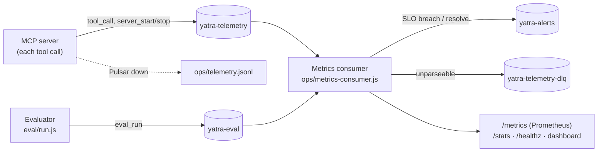

# Yatra Pulse operations runbook

How Yatra Pulse is observed, evaluated and kept healthy. Applies to the MCP server (`mcp-server/`), the evaluator (`eval/`) and the metrics pipeline (`ops/`). The web board itself runs inside claude.ai's sandbox, which blocks outbound connections, so it is covered by the evaluator and the browser tests rather than live telemetry.

## 1. Architecture



| Topic | Producer | Content |
|---|---|---|
| `yatra-telemetry` | MCP server | One event per tool call: tool, ok, latency, results, problems, clashes; server start/stop |
| `yatra-eval` | Evaluator | One event per run: metrics, thresholds, pass/fail, git commit |
| `yatra-alerts` | Metrics consumer | SLO `firing` / `resolved` transitions |
| `yatra-telemetry-dlq` | Metrics consumer | Telemetry that couldn't be parsed |

Pulsar runs locally from `ops/docker-compose.yml` (Apache Pulsar 4.2.4 standalone). All clients use Pulsar's WebSocket API (`PULSAR_WS_URL`, default `ws://localhost:8080/ws/v2`), so there are no native client libraries.

## 2. Start, stop, check

```bash
docker compose -f ops/docker-compose.yml up -d        # Pulsar (healthy in ~30 s)
node ops/metrics-consumer.js                          # http://localhost:9464
node eval/run.js                                      # evaluate and publish
cd mcp-server && TELEMETRY=pulsar npm test            # generate real tool traffic
```

| Check | Command | Healthy |
|---|---|---|
| Pulsar | `docker inspect -f '{{.State.Health.Status}}' yatra-pulsar` | `healthy` |
| Consumer | `curl -s localhost:9464/healthz` | `{"ok":true,"pulsar":"connected"}` |
| Backlog | `curl -s localhost:8080/admin/v2/persistent/public/default/yatra-telemetry/stats` | `msgBacklog` near 0 for `yatra-metrics` |
| Dashboard | open http://localhost:9464 | SLOs all OK |

Stop: `Ctrl-C` the consumer (it drains and exits), `docker compose -f ops/docker-compose.yml down` (add `-v` to delete data).

## 3. Service level objectives

Checked every 30 s over a rolling 15-minute window (`SLO_WINDOW_MS`). A breach publishes a `firing` alert once; recovery publishes `resolved`.

| SLO | Target | Minimum data | Why |
|---|---|---|---|
| Tool calls succeed | ≥ 99% | 20 calls | A failed call means Claude answers without the board |
| p95 tool latency | ≤ 250 ms | 20 calls | Tools run inside a conversation; the slowest tool is about 4 ms today |
| Searches that find something | ≥ 90% | 10 searches | Empty results push Claude to answer from memory |
| Latest evaluator run passes | pass | 1 run | Quality gate for search, trip check and plan checks |

## 4. Evaluator quality gates

`eval/thresholds.json`, run on every push by CI and on demand.

| Metric | Gate | Last run |
|---|---|---|
| retrieval_hit_at_1 | ≥ 0.80 | 0.968 |
| retrieval_recall_at_3 | ≥ 0.90 | 1.000 |
| retrieval_mrr_at_5 | ≥ 0.85 | 0.984 |
| tripcheck_accuracy | = 1.00 | 1.000 (10 scenarios) |
| plan_eval_accuracy | = 1.00 | 1.000 (4 plans) |
| search_p95_ms | ≤ 5 ms | 0.78 ms |

Known miss: "Kannada film stars Shivarajkumar" ranks Somanathapura first (its text says "star-shaped"); the right event is second.

## 5. Alerts: what to do

### Tool error rate high
1. Dashboard → MCP tools: which tool has errors?
2. Read the consumer and server logs (JSON on stderr) for `"level":"error"`, `"msg":"tool failed"`; each has a `trace_id` that matches the telemetry event.
3. Usual causes: `index.html` changed so `SHARED-START/END` can't be loaded, or a key format changed. Run `cd mcp-server && npm test`.
4. Roll back the last change to `index.html` if tests fail; fix forward otherwise.

### Tool latency high
1. Run `node eval/run.js` and compare `search_p95_ms` with the last run.
2. If the corpus grew, consider caching the BM25 index (it is rebuilt per call today).

### Search returns nothing
1. Set `TELEMETRY_INCLUDE_QUERIES=1` on the MCP server for an hour to see the failing queries (off by default because queries can be personal).
2. Add missing words to the event `note`, `CAT_WORDS`, `STYLE_WORDS` or `KNOWLEDGE`; add the query to `eval/datasets/retrieval.json`; run the evaluator.

### Evaluator failing
1. `node eval/run.js` prints each miss or failed scenario.
2. A drop after a data change usually means a renamed key or changed time; update the data or the dataset deliberately, never the threshold to make it pass.

### Pulsar down
1. Telemetry keeps flowing to `ops/telemetry.jsonl` (no data lost; tools unaffected).
2. `docker compose -f ops/docker-compose.yml ps` / `logs pulsar`; restart with `up -d`.
3. Producers and the consumer reconnect on their own with backoff (0.5 s to 30 s).

### Dead-letter messages
1. `docker exec yatra-pulsar bin/pulsar-client consume -s inspect -n 0 -p Earliest persistent://public/default/yatra-telemetry-dlq`
2. Find the producer sending non-JSON; telemetry must always be one JSON object per message.

## 6. Game day

Prove the alerting works before relying on it (last run: 11 Oct 2026, all as expected).

| Step | Command | Expect |
|---|---|---|
| Errors | `node ops/simulate.js errors` | availability drops to ~83%, `SLO firing` logged and on `yatra-alerts` |
| Slow | `node ops/simulate.js slow` | latency SLO breach |
| Empty searches | `node ops/simulate.js empty` | search SLO breach |
| Recover | `node ops/simulate.js healthy`, wait for the window | `SLO resolved` |
| Poison | `node ops/simulate.js poison` | message on `yatra-telemetry-dlq`, consumer keeps running |

## 7. Operational excellence practices

| Practice | How Yatra Pulse does it |
|---|---|
| Observe everything that decides for a traveller | Every tool call is an event with outcome, latency and domain results (results found, problems, clashes) |
| Never let observability hurt the service | Telemetry is fire-and-forget, buffered at startup, falls back to a file, and never throws into a tool |
| Measure quality, not just uptime | Labelled evaluator for search, trip check and plan grounding, with gates in CI |
| Clear objectives | Four SLOs with targets, data minimums and alerts that fire once and resolve once |
| Runbooks for every alert | Section 5; each Prometheus rule links here |
| Safe failure | Reconnect with backoff, dead-letter topic, negative-ack and redelivery on handler errors, graceful shutdown that drains |
| Small, tested changes | CI runs MCP tests and the evaluator on every push and pull request |
| Privacy by default | Search text isn't recorded unless `TELEMETRY_INCLUDE_QUERIES=1`; only a hash and length |
| Practise failure | Game-day script (section 6) |
| Data freshness | Event data is last-checked 11 Oct 2026; refresh before each festival day, then run the evaluator |

## 8. Before each release

1. `cd mcp-server && npm test` and `node eval/run.js` pass.
2. `.venv/bin/python tests/run_dashboard.py` passes (16 checks).
3. If event data changed: update `Last checked` in the footer and SPEC.
4. Publish the artifact; push to GitHub; watch the dashboard for 15 minutes.
